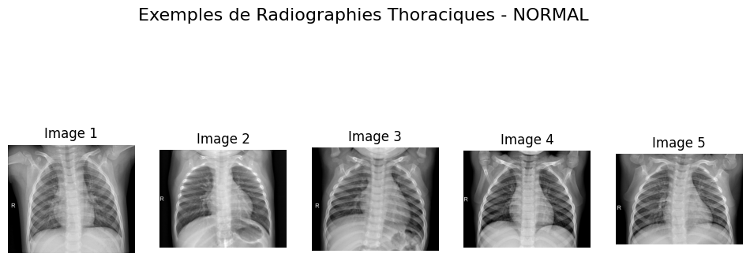
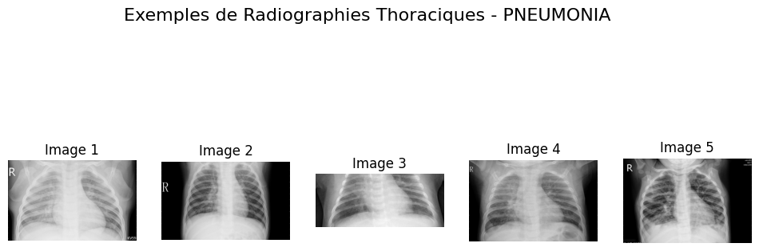
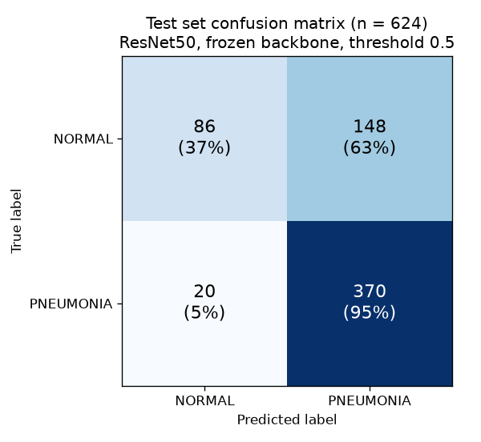
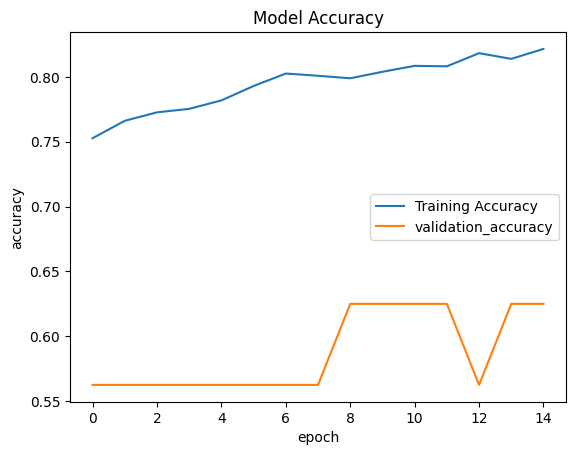

# Pneumonia Detection from Chest X-Rays


A deep learning pipeline that classifies pediatric chest X-rays as **NORMAL** or **PNEUMONIA**. It uses transfer learning from an ImageNet-pretrained **ResNet50**.

The project has two parts:

- **The original exploratory notebook.** It covers data exploration, model training, and test-set evaluation on a GPU.
- **A refactored Python package (`src/`).** It turns the notebook into a reproducible command-line pipeline and fixes the problems the first experiment exposed.

<p align="center">
  
  
</p>

---

## Results

These results come from the baseline experiment in [`notebooks/pneumonia_resnet50.ipynb`](notebooks/pneumonia_resnet50.ipynb). The ResNet50 backbone was frozen and the classification head was trained for 15 epochs. The model was then evaluated on the **624-image held-out test set**.

| Metric | Value |
|---|---|
| Test accuracy | **0.73** |
| ROC AUC | **0.868** |
| Pneumonia recall (sensitivity) | **0.95** |
| Pneumonia precision | 0.71 |
| Normal recall (specificity) | 0.37 |
| Weighted F1 | 0.70 |

<p align="center">
  
  
</p>

**Interpretation**

- The model misses very few pneumonia cases: 20 of 390 were missed. For a screening tool, catching most true cases matters most.
- Its weakness is false positives: 148 of 234 healthy patients were flagged as pneumonia. The training set has about 2.9 pneumonia images per normal image, so the model is biased toward the majority class.
- An AUC of 0.868 shows the model ranks images well, even though accuracy at the 0.5 threshold is only moderate. Choosing a better threshold or rebalancing the classes should improve specificity.
- The validation curve is flat and noisy because the official validation folder holds **only 16 images**. With so few images, one prediction moves validation accuracy by 6 points.

---

## From notebook to pipeline: what was improved

Reviewing the baseline revealed several issues. The `src/` package fixes each of them:

| Issue in the baseline | Fix in `src/` |
|---|---|
| 16-image validation set gives no usable training signal | A seeded 15% validation split is carved from the training set (`config.VALIDATION_SPLIT`) |
| 1:2.9 class imbalance pushes predictions toward PNEUMONIA | Inverse-frequency class weights (`data.compute_class_weights`) |
| Images rescaled to [0, 1], while ResNet50 was pretrained on `caffe`-style inputs (BGR, mean-subtracted) | ResNet50's own `preprocess_input`, embedded as a layer in the model so inference cannot apply it differently |
| Fine-tuning phase ran zero epochs (`initial_epoch` was larger than `epochs`) | Correct two-phase schedule: the head is trained first, then layers 140+ are unfrozen while BatchNorm stays frozen |
| Only accuracy was tracked | AUC, precision, and recall are tracked; checkpoints keep the best `val_auc`; early stopping and learning-rate reduction are added |
| No saved artifacts besides the notebook | Training history CSV, training curves, metrics JSON, confusion matrix, ROC and PR curves are written to `reports/` |

The baseline numbers above come from the notebook run. Running `python -m src.train` followed by `python -m src.evaluate` produces the metrics and figures for the improved pipeline.

---

## Dataset

[Chest X-Ray Images (Pneumonia)](https://www.kaggle.com/datasets/paultimothymooney/chest-xray-pneumonia), from Kermany et al., *Cell*, 2018. The dataset contains 5,856 anterior-posterior chest X-rays of pediatric patients aged one to five, from Guangzhou Women and Children's Medical Center.

| Split | NORMAL | PNEUMONIA | Total |
|---|---|---|---|
| Train | 1,341 | 3,875 | 5,216 |
| Validation | 8 | 8 | 16 |
| Test | 234 | 390 | 624 |

---

## Model

```
Input (224 x 224 x 3, raw pixels)
  -> Data augmentation  (rotation, translation, zoom, contrast; active only during training)
  -> ResNet50 preprocessing
  -> ResNet50 backbone  (ImageNet weights, include_top=False)
  -> GlobalAveragePooling2D
  -> Dense(512, ReLU) -> Dropout(0.3)
  -> Dense(1, sigmoid)  -> p(pneumonia)
```

| Phase | Trainable layers | Optimizer | Epochs |
|---|---|---|---|
| 1. Head training | Classification head only (about 1.05M parameters) | Adam, lr 1e-4 | 15 |
| 2. Fine-tuning | Head and ResNet50 layers 140+ (BatchNorm frozen) | Adam, lr 1e-5 | 10 |

Hyperparameters are defined in [`src/config.py`](src/config.py).

---

## Project structure

```
.
├── notebooks/
│   └── pneumonia_resnet50.ipynb   # Original experiment: EDA, training, evaluation (with outputs)
├── src/
│   ├── config.py                  # Paths and hyperparameters
│   ├── data.py                    # tf.data loading, augmentation, class weights
│   ├── model.py                   # ResNet50 model, fine-tuning helpers
│   ├── train.py                   # Two-phase training CLI
│   ├── evaluate.py                # Test-set metrics and plots CLI
│   └── predict.py                 # Single or batch image inference CLI
├── reports/
│   └── figures/                   # Sample images, training curves, confusion matrix
├── MODEL_CARD.md                  # Intended use, data, metrics, limitations
├── requirements.txt
└── README.md
```

---

## Getting started

### 1. Install

```bash
git clone https://github.com/<your-username>/XRay-Pneumonia-Classification.git
cd XRay-Pneumonia-Classification
python -m venv .venv
source .venv/bin/activate        # Windows: .venv\Scripts\activate
pip install -r requirements.txt
```

### 2. Download the data

You can use the [Kaggle CLI](https://github.com/Kaggle/kaggle-api) (this requires a Kaggle API token):

```bash
kaggle datasets download -d paultimothymooney/chest-xray-pneumonia -p data --unzip
```

You can also download the archive manually and extract it so that the following layout exists:

```
data/chest_xray/
├── train/{NORMAL,PNEUMONIA}/
├── val/{NORMAL,PNEUMONIA}/
└── test/{NORMAL,PNEUMONIA}/
```

### 3. Train

```bash
python -m src.train
# Options: --head-epochs 15 --fine-tune-epochs 10 --no-class-weights --data-dir PATH --output PATH
```

The best checkpoint, chosen by validation AUC, is saved to `models/resnet50_pneumonia.keras`. The training curves are saved to `reports/figures/training_curves.png`.

A GPU is strongly recommended. The baseline was trained on a Google Colab T4, where each epoch took about 100 seconds.

### 4. Evaluate

```bash
python -m src.evaluate --threshold 0.5
```

This writes `reports/metrics.json`, `reports/classification_report.txt`, and confusion matrix, ROC, and precision-recall plots to `reports/figures/`.

### 5. Predict

```bash
python -m src.predict path/to/xray1.jpeg path/to/xray2.jpeg
```

```
path/to/xray1.jpeg  PNEUMONIA  p(pneumonia) = 0.912
path/to/xray2.jpeg  NORMAL     p(pneumonia) = 0.143
```

---

## Limitations

This is an educational project, **not a diagnostic tool**. The data comes from a single pediatric center, so the model is unlikely to generalize to adults or other hospitals. Its probabilities are not calibrated. It may also rely on non-clinical image artifacts. See [`MODEL_CARD.md`](MODEL_CARD.md) for details.

## Future work

- Tune the decision threshold for a target sensitivity using the ROC curve, and calibrate probabilities with temperature scaling
- Add Grad-CAM heatmaps to check that predictions focus on lung regions rather than on artifacts
- Compare backbones such as EfficientNet, DenseNet121, and ConvNeXt using stratified k-fold cross-validation
- Serve the model behind a small Streamlit or FastAPI demo

## Tech stack

Python, TensorFlow / Keras, scikit-learn, NumPy, pandas, Matplotlib, Google Colab (GPU)

## Author

**Your Name**: [GitHub](https://github.com/<your-username>) | [LinkedIn](https://www.linkedin.com/in/<your-profile>)

## Acknowledgements

- Dataset: Kermany, D. S., et al. "Identifying Medical Diagnoses and Treatable Diseases by Image-Based Deep Learning." *Cell* 172.5 (2018).
- Kaggle dataset curated by Paul Mooney.
